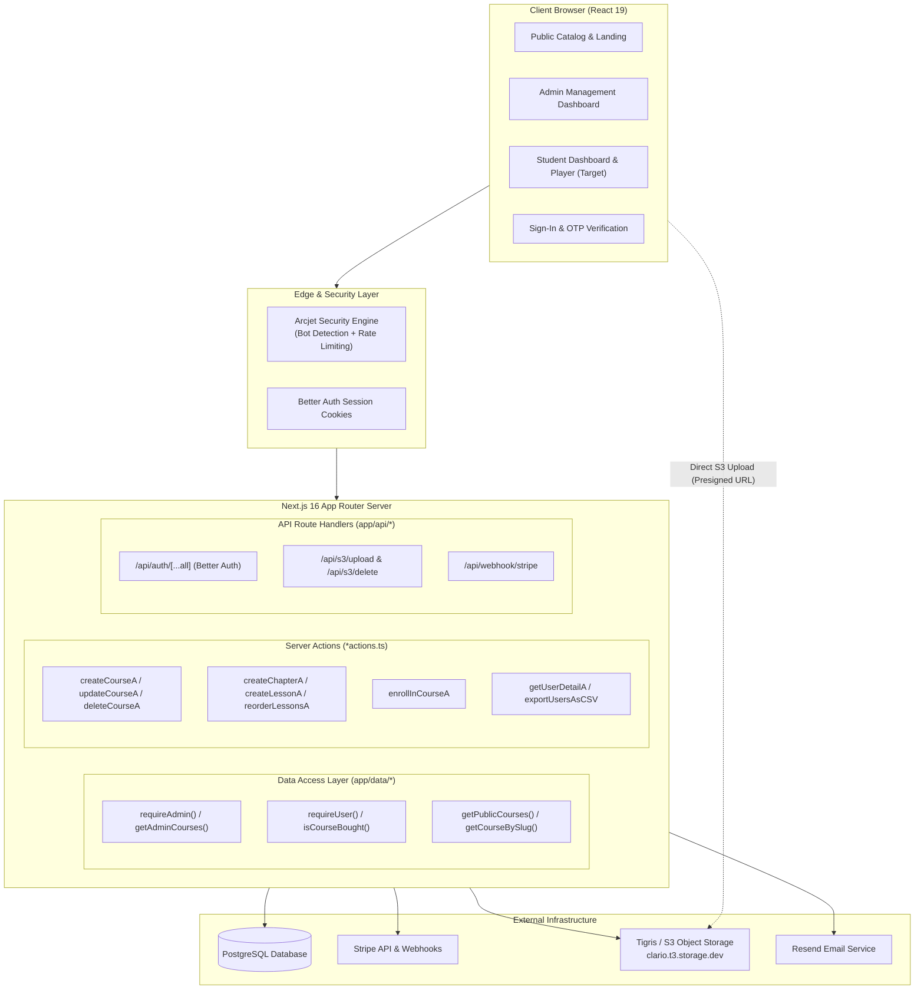
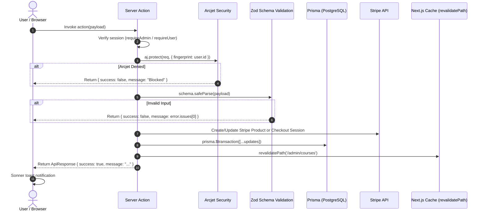
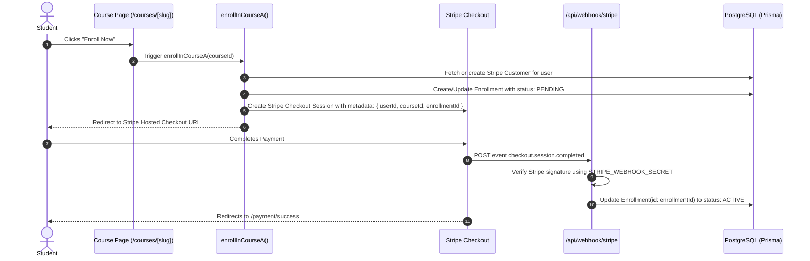

# Clario LMS — Architecture & System Design

## 1. System Overview

Clario is a modern, full-stack Learning Management System (LMS) built with **Next.js 16 (App Router)**, **React 19**, **TypeScript**, **Tailwind CSS 4**, and **Prisma ORM** over **PostgreSQL**.

The platform is designed around a multi-tier learning platform model:
- **Public/Marketing Tier**: Course discovery, course overview with rich syllabus, and student checkout.
- **Authentication & Security Tier**: Passwordless Email OTP & OAuth via Better Auth, secured with Arcjet bot detection and rate limiting.
- **Administrative Tier**: Course authoring (drag-and-drop curriculum builder, Tiptap rich text editor, S3 direct media uploads) and user management (session inspection, revocation, data export).
- **Commerce Tier**: Stripe Checkout integration with webhook-driven enrollment activation.
- **Student Tier (Under Construction)**: Student learning dashboard, video lesson player, curriculum navigation, and lesson completion tracking.

---

## 2. Core Tech Stack

| Domain | Technology | Version / Tooling | Purpose |
|---|---|---|---|
| **Framework** | Next.js App Router | `16.2.4` (Turbopack) | Server Components, Server Actions, Route Handlers |
| **Frontend Library** | React | `19.2.4` | UI Components, hooks (`useTransition`, `useOptimistic`) |
| **Language** | TypeScript | `5.9.3` | End-to-end type safety |
| **Styling** | Tailwind CSS | `4.1.18` + Radix UI | Utility-first styling with shadcn/ui components |
| **Icons** | Hugeicons & Tabler | `@hugeicons/react`, `@tabler/icons-react` | Unified icon system |
| **Database & ORM** | PostgreSQL + Prisma | Prisma `7.0.0` | Relational database modeling and type-safe queries |
| **Authentication** | Better Auth | `1.4.10` | Email OTP, Google/GitHub OAuth, Admin plugin |
| **Media Storage** | Tigris / AWS S3 SDK | `@aws-sdk/client-s3`, `@aws-sdk/s3-request-presigner` | Presigned URL direct uploads for thumbnails & videos |
| **Payments** | Stripe SDK | `20.3.0` | Stripe Checkout & webhook event processing |
| **Rich Text** | Tiptap | `3.32.1` | JSON-based rich text editor for course descriptions |
| **Curriculum DND** | `@hello-pangea/dnd` | `18.0.1` | Drag-and-drop chapter and lesson reordering |
| **Security & Abuse** | Arcjet | `1.0.0-beta.15` | Bot protection, rate limiting, attack mitigation |
| **Email Delivery** | Resend | `4.1.2` | Transactional emails (dev OTP logging + production delivery) |
| **Notifications** | Sonner | `2.0.7` | Modern toast notifications |

---

## 3. High-Level System Architecture

---

## 4. Communication & Interaction Patterns

The codebase adopts strict separation of concerns across data retrieval, mutations, and external integrations:

### 4.1 Data Access Layer (DAL) Pattern
All database read operations live inside `app/data/`:
- `app/data/admin/`: Admin-scoped queries (`getAdminCourses`, `getAdminCourse`, `getAdminUsers`, `requireAdmin`).
- `app/data/course/`: Public catalog queries (`getPublicCourses`, `getCourseBySlug`).
- `app/data/user/`: Student-scoped queries (`requireUser`, `isCourseBought`).

**Key DAL Characteristics:**
1. **Server Boundary Enforcement**: Every DAL file declares `import "server-only"` to prevent accidental client bundling.
2. **Dynamic Request Context**: Functions extract the caller's session via `auth.api.getSession({ headers: await headers() })`.
3. **Redirect-Based Guarding**: Helper guards like `requireAdmin()` redirect unauthenticated or non-admin users before any layout or page executes.

### 4.2 Server Action Mutation Pattern
All write operations are modeled as Next.js Server Actions (`"use server"`):

### 4.3 Direct S3 Upload Pattern
Uploading heavy assets (video files, high-res thumbnails) never traverses the Next.js server memory:
1. Client calls `POST /api/s3/upload` with metadata: `{ fileName, contentType, size, isImage }`.
2. Route handler authorizes admin caller via `requireAdmin()`, validates metadata via `fileUploadSchema`, and generates an S3 presigned PUT URL with `@aws-sdk/s3-request-presigner`.
3. Server returns `{ uploadUrl, key }`.
4. Client uploads the binary payload directly to Tigris/S3 via `fetch(uploadUrl, { method: "PUT", body: file })`.
5. On upload completion, the client passes `key` to the Server Action to persist in the database.

### 4.4 Checkout & Enrollment Lifecycle

---

## 5. Security & Isolation Architecture

1. **Defense-in-Depth Authentication**:
   - Authentication state is tracked via HTTP-only, secure session cookies managed by Better Auth.
   - Admin routes rely on server-side validation (`requireAdmin()`) rather than client-exposed JWTs.
2. **Arcjet Abuse Prevention**:
   - `detectBot`: Rejects unauthorized bots and scrapers on administrative endpoints.
   - `fixedWindow`: Limits critical actions (e.g., maximum 3 course creations per 5 minutes; maximum 5 enrollment checkout creations per 1 minute).
3. **Database Guardrails**:
   - Foreign key cascading deletes (`onDelete: Cascade`) ensure that deleting a course cleans up all child chapters, lessons, and enrollments.
   - Unique constraints on `[userId, courseId]` ensure users cannot double-enroll in the same course.
