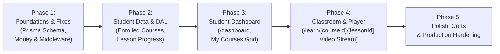

# Clario LMS — Implementation Roadmap & Execution Plan

This document outlines the phased roadmap to complete the Clario LMS platform, transitioning it from an administrative MVP to a full-featured commercial learning platform.

---

## 1. Roadmap Phases Overview

---

## 2. Phase-by-Phase Execution Plan

### Phase 1: Core Fixes & Schema Extension
**Objective**: Prepare the database and middleware foundation for student learning and payment stability.

- [ ] **1.1 Add `LessonProgress` Model to Prisma**:
  - Define `model LessonProgress` in `prisma/schema.prisma` linking `userId` and `lessonId` with a unique compound index.
  - Add `stripeProductId String?` to `model Course` to fix the Stripe product update bug.
  - Generate and run Prisma migration (`pnpm db:migrate`).
- [ ] **1.2 Fix Stripe & Money Robustness**:
  - Enforce `Math.round(price * 100)` when creating Stripe prices.
  - In course creation action, store `stripeProduct.id` as `stripeProductId`.
  - In course edit action, update Stripe product via `stripe.products.update(course.stripeProductId)`.
- [ ] **1.3 Activate Edge Route Protection (`middleware.ts`)**:
  - Rename or wrap `proxy.ts` into a standard Next.js `middleware.ts`.
  - Update matcher to guard `["/admin/:path*", "/dashboard/:path*", "/learn/:path*"]`.

---

### Phase 2: Student Data Access Layer (DAL)
**Objective**: Build server-only queries to fetch student enrollments and calculate real-time progress.

- [ ] **2.1 Student Queries (`app/data/student/`)**:
  - `getEnrolledCourses(userId: string)`:
    - Queries active enrollments for the user.
    - Computes total lessons count vs completed lessons count.
    - Returns progress percentage: `Math.round((completedLessons / totalLessons) * 100)`.
    - Identifies `nextLessonId` (first uncompleted lesson or first lesson).
  - `getCoursePlayerState(courseId: string, lessonId: string, userId: string)`:
    - Verifies active enrollment; throws 403 or redirects if unenrolled.
    - Fetches current lesson details (video key, title, description).
    - Fetches full course curriculum with completion status for each lesson.
    - Identifies adjacent lessons (`prevLessonId`, `nextLessonId`).
- [ ] **2.2 Student Progress Server Actions**:
  - `toggleLessonProgressA(lessonId: string, completed: boolean)`:
    - Upserts `LessonProgress` record for the user.
    - Revalidates `/dashboard` and `/learn/[courseId]/[lessonId]`.

---

### Phase 3: Student Dashboard (`/dashboard`)
**Objective**: Provide a personalized home for students upon login and enrollment.

- [ ] **3.1 Student Portal Layout (`app/dashboard/layout.tsx`)**:
  - Shared navigation with user profile dropdown, links to "My Courses", "Browse Catalog", and "Admin" (if admin).
- [ ] **3.2 Dashboard Overview Page (`app/dashboard/page.tsx`)**:
  - **Metric Cards**:
    - Courses In Progress.
    - Completed Courses.
    - Total Hours Learned.
  - **Continue Learning Banner**:
    - Prominently showcases the last accessed course with a progress bar and direct "Resume Lesson" button.
  - **Enrolled Courses Grid**:
    - Cards featuring course thumbnail, title, category, progress bar (`X%`), and "Go to Classroom" button.
- [ ] **3.3 Empty State**:
  - Friendly CTA directing users to the course catalog (`/courses`) if no active enrollments exist.

---

### Phase 4: Classroom & Video Player Experience
**Objective**: Deliver a seamless video watching and syllabus navigation interface.

- [ ] **4.1 Classroom Layout & Route (`app/learn/[courseId]/[lessonId]/page.tsx`)**:
  - Clean, distraction-free theater layout.
  - Top navigation bar: "Back to Dashboard", course title, progress indicator.
- [ ] **4.2 Responsive Video Player Component (`components/player/video-player.tsx`)**:
  - Streams video from Tigris/S3 bucket using the lesson's `videoFileKey`.
  - Includes playback rate controls (1x, 1.25x, 1.5x, 2x), fullscreen, and theater mode.
  - Auto-triggers "Mark as Complete" when video playback reaches >90% (optional toggle).
- [ ] **4.3 Curriculum Sidebar Accordion (`components/player/course-sidebar.tsx`)**:
  - Shows all chapters and lessons.
  - Highlights currently active lesson.
  - Interactive checkboxes to toggle lesson completion.
  - Displays checkmarks on completed lessons.
- [ ] **4.4 Lesson Details & Navigation Controls**:
  - Renders lesson description using Tiptap content.
  - "Previous Lesson" and "Next Lesson / Complete" buttons at the bottom of the video.

---

### Phase 5: Polish & Production Hardening
**Objective**: Ensure the platform is ready for commercial production traffic.

- [ ] **5.1 Course Completion Certificate / Modal**:
  - Celebration modal triggers when course reaches 100% completion.
  - Downloadable or viewable completion certificate.
- [ ] **5.2 Error & Not Found Boundaries**:
  - Create user-friendly `app/not-found.tsx` and `app/error.tsx`.
- [ ] **5.3 Real Integration Testing**:
  - Test real checkout flow using Stripe test clock.
  - Verify Tigris S3 video streaming and playback across mobile and desktop.
